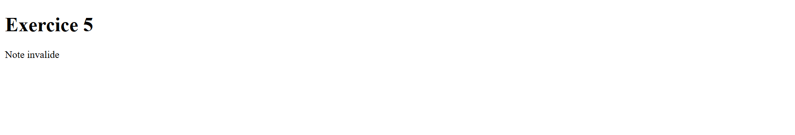
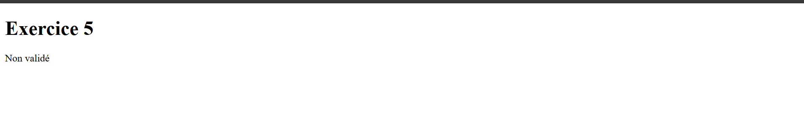
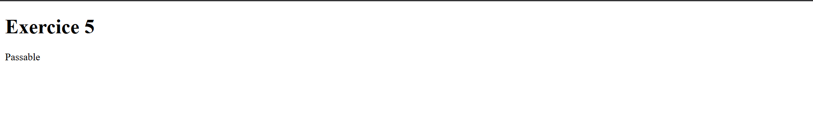
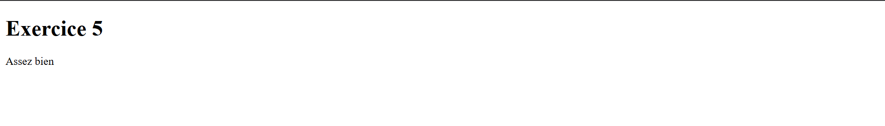
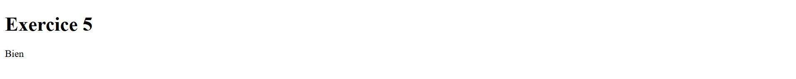
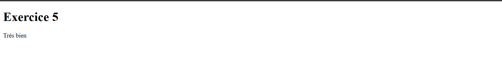
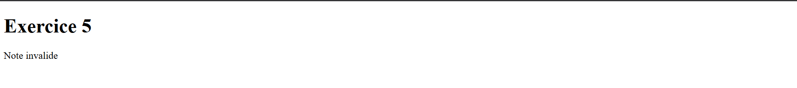
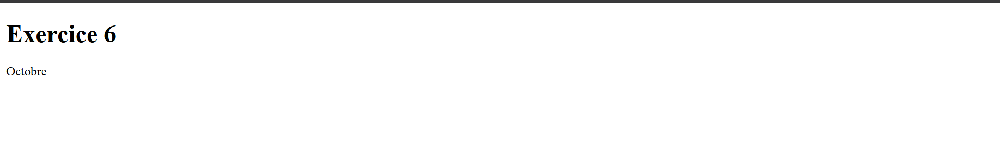

# TP02-PHP-Rida-Hibatolah
TP 02 PHP - Programmation Web2 - 2026/2027
## Informations
Nom : Rida
Prenom : hibatolah
Groupe : 03
titre : TP02 PHP
## Réalisation du TP

Ce travail pratique a été réalisé en collaboration avec ma camarade **[Arwa M'barki]**. Nous avons travaillé ensemble sur les différents exercices afin de comprendre et d'appliquer les notions étudiées en programmation PHP.
## Liste des exercices
 Exercice 1
 Exercice 2
 Exercice 3
 Exercice 4
 Exercice 5
 Exercice 6
 Exercice 7
 Exercice 8
 Exercice 9
 Exercice 10 - GET
 Exercice 10 - POST
## Exercice 2 — Variables en PHP
 ### Différence entre $note et $Note

 En PHP, les noms des variables sont sensibles à la casse 

 Donc `$note` et `$Note` sont deux variables différentes.

 ### Noms de variables valides

 Les noms de variables valides en PHP :
  - `$a`
  - `$_a`
  - `$a_a`
  - `$AAA`
  - `$a1`
  ### Exercice 5 
 Tester successivement -1, 9, 10, 12, 14, 16 et 21 en changeant la variable.
 
 
 
 
 
 

 ### Exercice 6 
5. Remplacer ensuite la valeur fixe par (int) date("m") pour afficher le mois courant du serveur.

